# RideEscrow Smart Contract Architecture (Box Storage)

## 1. Overview
The rewritten `RideEscrow` smart contract utilizes **Algorand Box Storage** to escrow multiple concurrent rides independently.
Every ride is keyed by `sha256(rider_address || ride_id)`, eliminating single-ride global state bottlenecks and preventing third-party ID squatting.

---

## 2. Key Derivation & Box Sizing

### Box Key
* **Formula**: `sha256(rider.bytes || ride_id.bytes)`
* **Key Size**: 32 bytes (raw 256-bit hash)
* **Squatting Prevention**: Because the rider's public address is hashed into the box key, a different account cannot pre-allocate or squat on another rider's `ride_id`.
* **Method Signatures**: All post-booking methods take `(rider: arc4.Address, ride_id: arc4.String)` and derive the identical 32-byte key.

### Box Value Layout (`RideState`)
An `arc4.Struct` with 5 fixed-size fields:
* `rider`: `arc4.Address` (32 bytes)
* `driver`: `arc4.Address` (32 bytes)
* `amount`: `arc4.UInt64` (8 bytes) — net fare locked for the driver
* `status`: `arc4.UInt8` (1 byte) — active ride status (0-3)
* `round`: `arc4.UInt64` (8 bytes) — block round recorded at drop-off or dispute

**Total Value Size**: $32 + 32 + 8 + 1 + 8 = \mathbf{81\text{ bytes}}$.

---

## 3. Box Minimum Balance Requirement (MBR)

Under Algorand AVM rules:
$$\text{Box MBR} = 2,500 + 400 \times (\text{len}(\text{key}) + \text{len}(\text{value}))\text{ microAlgos}$$

* Key length = 32 bytes
* Value length = 81 bytes
* Total stored bytes = $32 + 81 = 113\text{ bytes}$
$$\text{BOX\_MBR} = 2,500 + (400 \times 113) = 2,500 + 45,200 = \mathbf{47,700\text{ microAlgos}}\ (0.0477\text{ ALGO})$$

### MBR Lifecycle
1. **Funding (at `book_trip`)**:
   * Rider provides `pay.amount >= MIN_FARE + BOX_MBR` ($100,000 + 47,700 = 147,700\text{ microAlgos}$).
   * Contract creates the box, consuming 47,700 microAlgos MBR.
   * `amount` stored in box = `pay.amount - BOX_MBR`.
2. **Refunding (on terminal transition)**:
   * The box is deleted via `del self.rides[box_key]`, instantly releasing 47,700 microAlgos back to the contract's available balance.
   * The 47,700 microAlgos is returned to the rider who funded it via inner payment.

---

## 4. Global State & Administrative Controls

* `admin: Account`: Initialized to `Global.creator_address`.
* `timeout_rounds: UInt64`: Dropoff confirmation timeout set upon app creation.
* `dispute_timeout_rounds: UInt64`: Resolution timeout set upon app creation.
* `set_admin(new_admin: Account)`: Restricted strictly to `Txn.sender == Global.creator_address`.

---

## 5. State Machine & Status Codes

Statuses stored in box (0-3 only):
* `0 = BOOKED`: Rider escrowed fare + MBR; waiting for driver to pick up.
* `1 = STARTED`: Driver started trip.
* `2 = DROPPED`: Driver marked drop-off; `round = Global.round`.
* `3 = DISPUTED`: Rider disputed trip; `round = Global.round`.

*(Note: Terminal states `COMPLETED` and `CANCELLED` delete the box completely).*

```mermaid
stateDiagram-v2
    [*] --> BOOKED : book_trip (Rider locks fare + MBR)
    
    BOOKED --> [*] : cancel_trip (Rider or Driver; Rider receives fare + MBR)
    BOOKED --> STARTED : start_ride (Driver only)
    
    STARTED --> DROPPED : mark_dropoff (Driver only; stores Global.round)
    STARTED --> DISPUTED : raise_dispute (Rider only; stores Global.round)
    STARTED --> [*] : confirm_complete (Rider confirms; Driver gets fare, Rider gets MBR)
    
    DROPPED --> DISPUTED : raise_dispute (Rider only, if round < stored_round + timeout)
    DROPPED --> [*] : confirm_complete (Rider confirms; Driver gets fare, Rider gets MBR)
    DROPPED --> [*] : claim_after_timeout (Driver only, if round >= stored_round + timeout; Driver gets fare, Rider gets MBR)
    
    DISPUTED --> [*] : resolve_dispute(pay_driver=True) (Admin only; Driver gets fare, Rider gets MBR)
    DISPUTED --> [*] : resolve_dispute(pay_driver=False) (Admin only; Rider gets fare + MBR)
    DISPUTED --> [*] : reclaim_after_dispute_timeout (Rider only, if round >= dispute_round + dispute_timeout; Rider gets fare + MBR)
```

---

## 6. Fee Budgeting & Pooling Documentation

In Algorand AVM, inner transactions (`itxn`) set `fee=0`, meaning the caller's outer transaction group must supply the required fee via Algorand fee pooling:
$$\text{Outer Transaction Fee} = 1,000 \times (1 + \text{Number of Inner Transactions})\text{ microAlgos}$$

| Method | Inner Payments | Outer App Call Fee | Payout Breakdown |
| :--- | :---: | :---: | :--- |
| `book_trip` | 0 | 1,000 µALGO | (Rider pay txn pays its own 1,000 µALGO) |
| `cancel_trip` | 1 | 2,000 µALGO | Rider refunded `fare + BOX_MBR` |
| `start_ride` | 0 | 1,000 µALGO | No payments |
| `mark_dropoff` | 0 | 1,000 µALGO | No payments |
| `confirm_complete` | 2 | 3,000 µALGO | Driver receives `fare`; Rider refunded `BOX_MBR` |
| `claim_after_timeout` | 2 | 3,000 µALGO | Driver receives `fare`; Rider refunded `BOX_MBR` |
| `raise_dispute` | 0 | 1,000 µALGO | No payments |
| `resolve_dispute(pay_driver=True)` | 2 | 3,000 µALGO | Driver receives `fare`; Rider refunded `BOX_MBR` |
| `resolve_dispute(pay_driver=False)` | 1 | 2,000 µALGO | Rider refunded `fare + BOX_MBR` |
| `reclaim_after_dispute_timeout` | 1 | 2,000 µALGO | Rider refunded `fare + BOX_MBR` |
| `set_admin` | 0 | 1,000 µALGO | No payments |

---

## 7. ARC-28 Events

Every lifecycle transition emits an ARC-28 compliant event with standard signature:
`EventName(string,address,address,uint64)`
* `Booked(string,address,address,uint64)`
* `Started(string,address,address,uint64)`
* `Dropped(string,address,address,uint64)`
* `Completed(string,address,address,uint64)`
* `Cancelled(string,address,address,uint64)`
* `Claimed(string,address,address,uint64)`
* `Disputed(string,address,address,uint64)`
* `Resolved(string,address,address,uint64)`
All events pass `(ride_id, rider, driver, amount)`.
